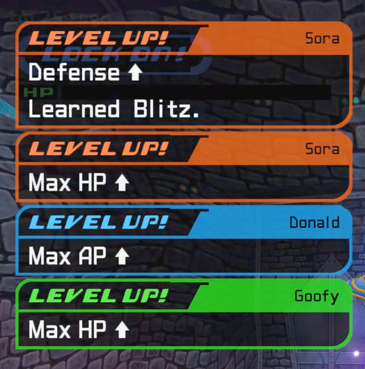

# Level Up Notices – 8 Seconds

More time to read your level-up rewards. Keeps the original party level-up
cards visible for eight seconds before their normal fade, including stat
increases and learned abilities.

**Version 1.0.0** · by **ROXASBrandon** ·
[Download ZIP](https://github.com/ROXASBrandon/KH1FM-Level-Up-Notices/releases/download/v1.0.0/KH1FM-Level-Up-Notices-v1.0.0.zip) ·
[Release notes](https://github.com/ROXASBrandon/KH1FM-Level-Up-Notices/releases/tag/v1.0.0)



*Original in-game cards. The mod preserves their appearance and extends their display time.*

## Features

- Eight-second hold for party level-up cards, followed by the original fade.
- Includes stat increases and learned-ability messages.
- Each card has its own timer; consecutive level-ups are supported.
- Uses elapsed time rather than a fixed number of frames.
- Preserves EXP, levels, rewards, stats and save data.
- Compatible with [Next Level Tracker](https://github.com/ROXASBrandon/KH1FM-Next-Level-Tracker), whose shorter EXP counter still appears afterward.

## Requirements

- **Kingdom Hearts Final Mix, Steam Global/WW version 1.0.0.2.**
- **LuaBackend**, installed and working for KH1.
- **OpenKH Mod Manager with Panacea configured** for the Mod Manager methods below.

Other game versions and regions are unsupported. LuaBackend, Panacea and game
files are not included. No compiler or Python installation is needed to play.

## Install

Close KH1 before installing or updating. Choose one method and keep only one
copy enabled.

### Method 1 – OpenKH GitHub installation

1. Select **KH1** in OpenKH Mod Manager and open **Mods > Install new mods**.
2. Use the GitHub repository installation option and enter:
   `ROXASBrandon/KH1FM-Level-Up-Notices`.
3. Install and enable **Level Up Notices - 8 Seconds**.
4. Click **Build and Run**.

### Method 2 – OpenKH ZIP import

1. Download **KH1FM-Level-Up-Notices-v1.0.0.zip** from the
   [release Assets](https://github.com/ROXASBrandon/KH1FM-Level-Up-Notices/releases/tag/v1.0.0).
2. In **Mods > Install new mods**, choose
   **Select and install Mod Archive or Lua Script**.
3. Select the ZIP **without extracting it**.
4. Enable **Level Up Notices - 8 Seconds**, then click **Build and Run**.

Use the named mod ZIP rather than GitHub's automatically generated source archives.

### Method 3 – Manual LuaBackend installation

If you already use a working manual LuaBackend setup, copy
`scripts/kh1_level_up_notices.lua` into its KH1 script folder and
`scripts/io_packages/kh1_level_up_notices.dll` into that folder's
`io_packages` subfolder. Restart KH1. Do not also enable a Mod Manager copy.

## Use and troubleshooting

No hotkey or configuration is needed. Level up normally.
The F2 LuaBackend console should report:

```text
[Level Up Notices] Ready: native cards hold for 8 seconds.
```

If cards still disappear quickly, check that the mod is enabled, rebuild, and
restart the game. An unsupported-build or missing-helper message means the
requirements or installed files need checking. Updating or reloading the script
alone cannot replace a loaded DLL; close and restart KH1 after updates.

## Remove or update

Close KH1, disable or remove this mod in Mod Manager, rebuild, and restart.
For manual installations, remove the Lua file and its DLL, then restart.
Original notification timing returns. No save conversion is required.

For a GitHub install, check for mod updates and rebuild. For a ZIP install,
remove the old imported copy before importing the new ZIP. Avoid duplicate
GitHub, ZIP and manual installations.

## Compatibility and limits

The game's original five-card queue per party slot still applies; this mod does
not increase queue capacity. Custom notifications that use the game's standard
party-card colors also receive the extended duration. Other HUD or timer
replacement mods are unverified.

A card whose native timer stops advancing does not consume its display time.
Gameplay pause and transition behavior was checked on the author's setup.
Guest-party level-ups and live gameplay at other frame-rate settings have not
been separately confirmed. A separate clean-PC installation is untested.

## Validation

Gameplay confirmed by the author:

- Party level-up cards last eight seconds.
- Consecutive level-ups and combined ability/stat rewards work.
- Pauses and transitions work without reported issues.
- Next Level Tracker still appears afterward.
- Removal restores original timing; the author reported all final tests complete.

Automated checks cover timing at 30/60/120 Hz, paused timers, reused card slots,
custom-card exclusion, and clearing cards. Exact executable signatures, actual
OpenKH Patcher output, ZIP contents and release-file checksums are checked
separately. Automated checks do not replace gameplay testing.

## Source and build

The gameplay-tested native helper is included. To rebuild, install Python with
`ziglang==0.16.0`, then run:

```sh
python native/build.py
python tools/package.py
```

The native adapter checks the supported executable's timer instructions and
chains the existing frame callback. It changes only active notification timers.
A two-second Lua heartbeat stops extensions if the script stops executing. The
DLL remains loaded until the game exits. Executable files on disk are untouched.

See [CHANGELOG.md](CHANGELOG.md), [CREDITS.md](CREDITS.md) and [LICENSE](LICENSE). Code is MIT-licensed;
Kingdom Hearts and the gameplay image belong to their respective owners.
